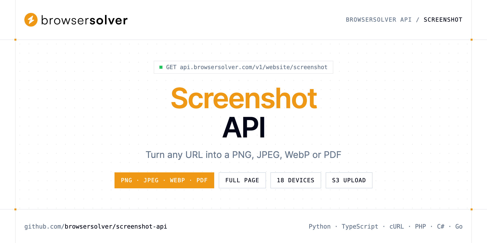

<p align="center">
  <a href="https://www.browsersolver.com"></a>
</p>

# Screenshot API

[](https://discord.gg/CFj3ph8aHU) [](https://app.browsersolver.com/register) [](https://app.browsersolver.com/openapi) [](LICENSE)

The **BrowserSolver Screenshot API** turns any public URL into an image or PDF. The response body is the file itself, ready to save, display or upload to your storage.

- **Website Screenshot API** — Turn any public URL into a PNG, JPEG, WebP, or PDF asset rendered by BrowserSolver.

Use it for link previews, visual monitoring, QA, reporting and archiving — without running Chromium yourself.

| Endpoint | Request | Credits |
|---|---|---|
| [Website Screenshot API](#website-screenshot-api) | `GET /v1/website/screenshot` | 2 |

## Table of contents

- [How it works](#how-it-works)
- [Website Screenshot API](#website-screenshot-api)
- [Code examples in other languages](#code-examples-in-other-languages)
- [Use cases](#use-cases)
- [Why BrowserSolver?](#why-browsersolver)
- [FAQ](#faq)
- [Official SDKs](#official-sdks)
- [Related repositories](#related-repositories)
- [Support](#support)

## How it works

1. **Create a BrowserSolver account** and copy your API key from the [dashboard](https://app.browsersolver.com/register).
2. **Call `https://api.browsersolver.com`** with the header `x-api-key: YOUR_API_KEY`.
3. **Use the result** in your app — no infrastructure to run.

```bash
export BROWSERSOLVER_API_KEY="your-api-key"
pip install requests        # Python
# TypeScript: Node.js 18+ (native fetch), run with `npx tsx file.ts`
```

## Website Screenshot API

Turn any public URL into a PNG, JPEG, WebP, or PDF asset rendered by BrowserSolver. No local Chromium fleet to operate.

`GET https://api.browsersolver.com/v1/website/screenshot` · **2 credits per request** · [API reference](https://app.browsersolver.com/openapi)

### Request parameters

| Parameter | In | Type | Required | Description |
|---|---|---|---|---|
| `url` | query | string | ✅ | Page address to render into an image or PDF. Must include a protocol. |
| `format` | query | string (`jpeg`, `jpg`, `pdf`, `png`, `webp`) | — | File type returned in the response body. |
| `device` | query | string (`galaxy_fold4`, `galaxy_s23`, `galaxy_s23_ultra`, `galaxy_s8`, `huawei_mate_50_pro`, `huawei_p60_pro`) | — | Swap the desktop viewport for a preset handset or tablet fingerprint. |
| `full_page` | query | boolean | — | Extend the capture beyond the viewport so the entire scrollable document is included. |
| `full_page_scroll` | query | boolean | — | Drive a scroll pass first so deferred content mounts before a tall capture. |
| `full_page_scroll_duration` | query | number | — | Milliseconds spent scrolling prior to a full-height capture. |
| `viewport_width` | query | number | — | Width of the synthetic desktop window, in pixels. |
| `viewport_height` | query | number | — | Height of the synthetic desktop window, in pixels. |
| `scale_factor` | query | number | — | Pixel density multiplier. Raise it for retina-quality output; files grow accordingly. |
| `image_quality` | query | string | — | Lossy compression level for soft formats. |
| `selector` | query | string | — | Limit the shot to one DOM node matched by this CSS selector. |
| `cache` | query | boolean | — | Serve a stored capture on repeat requests when caching is enabled. |
| `cache_ttl` | query | number | — | Lifetime of cached captures in seconds. |
| `remove_selectors` | query | string | — | Hide matching CSS selectors (modals, promo bars, etc.) before shooting. |
| `remove_cookie_banners` | query | boolean | — | Best-effort removal of cookie consent layers before capture. |
| `remove_ads` | query | boolean | — | Best-effort stripping of ad slots before capture. |
| `block_resources` | query | string (`document`, `eventsource`, `fetch`, `font`, `image`, `manifest`) | — | Resource kinds to discard during load, as a comma list (example: `image,stylesheet,font`). |
| `block_urls` | query | string | — | Substring patterns that should never be fetched (example: `analytics,tracking,advertisement`). Hosts, paths, or fragments such as `.example.com/` work. |
| `delay` | query | number | — | Additional settle time in seconds after the readiness event. |
| `wait_until` | query | array (`domcontentloaded`, `load`, `networkidle0`, `networkidle2`) | — | Which browser lifecycle event marks the page ready. |
| `wait_for_selector` | query | string | — | Hold capture until this CSS node is present. |
| `proxy` | query | string | — | Route the browser through an intermediate proxy. |
| `s3_secret_key` | query | string | — | Secret key used to authenticate uploads. |
| `s3_access_key_id` | query | string | — | Access key used to authenticate uploads. |
| `s3_bucket` | query | string | — | Destination bucket for the binary asset. |
| `s3_object_key` | query | string | — | Key under which the object is stored (generated automatically if blank). |
| `s3_region` | query | string | — | Cloud region of the bucket. |
| `storage_endpoint` | query | string | — | Override the default AWS endpoint for S3-compatible backends. Leave blank for AWS. R2 example: `https://<accountId>.r2.cloudflarestorage.com`. |
| `s3_url` | query | boolean | — | Upload the binary and include the public object URL in the API response. |

### Python example

```python
import os

import requests

API_KEY = os.environ["BROWSERSOLVER_API_KEY"]
HEADERS = {"x-api-key": API_KEY}

response = requests.get(
    "https://api.browsersolver.com/v1/website/screenshot",
    headers=HEADERS,
    params={
        "url": "https://www.amazon.com/s?k=pokemon",
    },
    timeout=120,
)
response.raise_for_status()

with open("screenshot.png", "wb") as f:
    f.write(response.content)
print("Saved screenshot.png", len(response.content), "bytes")
```

### TypeScript example

```typescript
import { writeFile } from "node:fs/promises";

const headers = { "x-api-key": process.env.BROWSERSOLVER_API_KEY!, "Content-Type": "application/json" };

const params = new URLSearchParams({
  "url": "https://www.amazon.com/s?k=pokemon",
});

const response = await fetch(`https://api.browsersolver.com/v1/website/screenshot?${params}`, { headers });
if (!response.ok) throw new Error(`HTTP ${response.status}: ${await response.text()}`);

await writeFile("screenshot.png", Buffer.from(await response.arrayBuffer()));
console.log("Saved screenshot.png");
```

### Output

The response body is the generated file (saved as `screenshot.png` in every example). Error responses are JSON with an explanatory message.

## Code examples in other languages

Ready-to-run examples live in [`examples/`](examples); each reads your key from `BROWSERSOLVER_API_KEY`.

| Language | `screenshot` |
|---|---|
| cURL (Bash) | [screenshot.sh](examples/curl/screenshot.sh) |
| PHP | [screenshot.php](examples/php/screenshot.php) |
| C# | [Screenshot.cs](examples/csharp/Screenshot.cs) |
| Go | [screenshot.go](examples/go/screenshot.go) |
| Java | [ScreenshotExample.java](examples/java/ScreenshotExample.java) |
| Ruby | [screenshot.rb](examples/ruby/screenshot.rb) |
| Node.js | [screenshot.mjs](examples/nodejs/screenshot.mjs) |

## Use cases

- **Link previews & thumbnails** — Generate website thumbnails for directories, CRMs and dashboards.
- **Visual monitoring** — Capture pages on a schedule and compare them over time.
- **Mobile QA** — Render pages with handset and tablet presets such as `iphone_14_pro` or `pixel_7_pro`.
- **Archiving** — Keep PDF or image proof of a page at a point in time.

## Why BrowserSolver?

- **Three fetch tiers** — Crawler for static HTML, Rendering for JavaScript pages, WebUnlocker for hosts that still challenge a headless browser.
- **Know before you fetch** — the Antibot endpoint names the bot-protection vendor in front of a URL so you can choose the right tier.
- **Screenshots as a service** — PNG, JPEG, WebP or PDF, full page, 18 device presets, cookie banner and ad removal, S3 upload.
- **Technology detection** — CMS, frameworks, analytics, CDN and security tooling of any public URL.
- **Copy-paste examples** — Python and TypeScript in each README, 7 more languages in `examples/`.

## FAQ

### How do I authenticate?

Create an account on [BrowserSolver](https://app.browsersolver.com/register), copy your API key and send it in the `x-api-key` header of every request to `https://api.browsersolver.com`.

### How much does a request cost?

Credits per call: `/v1/website/screenshot` **2**. See [BrowserSolver pricing](https://www.browsersolver.com/pricing).

### What does the API return?

The response body is the file itself (image or document). Save it directly to disk or stream it to your storage — every example in this repository writes the file locally.

### Which formats are supported?

`png`, `jpeg`/`jpg`, `webp` and `pdf` — set `format`.

### Can I remove cookie banners and ads?

Yes: `remove_cookie_banners`, `remove_ads`, or hide anything with `remove_selectors`.

### Can the file go straight to my bucket?

Yes, pass your S3-compatible storage parameters (`s3_bucket`, `s3_object_key`, …) — see the reference.

### Which languages are supported?

Any language that can make an HTTP request. This README shows Python and TypeScript; the [`examples/`](examples) folder contains cURL, PHP, C#, Go, Java, Ruby and Node.js.

## Official SDKs

Use BrowserSolver from your own language with a typed client:

| SDK | Package | Install |
| --- | --- | --- |
| Node.js | [`@browsersolver/sdk`](https://www.npmjs.com/package/@browsersolver/sdk) | `npm install @browsersolver/sdk` |
| Python | [`browsersolver`](https://pypi.org/project/browsersolver/) | `pip install browsersolver` |
| Go | [`browsersolver-go`](https://pkg.go.dev/github.com/browsersolver/browsersolver-go) | `go get github.com/browsersolver/browsersolver-go` |
| .NET | [`BrowserSolver`](https://www.nuget.org/packages/BrowserSolver) | `dotnet add package BrowserSolver` |
| Ruby | [`browsersolver`](https://rubygems.org/gems/browsersolver) | `gem install browsersolver` |
| PHP | [`browsersolver/sdk`](https://packagist.org/packages/browsersolver/sdk) | `composer require browsersolver/sdk` |
| Java | [`browsersolver-java`](https://github.com/browsersolver/browsersolver-java) | build from source, see its README |
| CLI | [`@browsersolver/cli`](https://www.npmjs.com/package/@browsersolver/cli) | `npm install -g @browsersolver/cli` |
| MCP server | [`@browsersolver/mcp`](https://www.npmjs.com/package/@browsersolver/mcp) | `npx -y @browsersolver/mcp` |

## Related repositories

- [Web Unlocker API](https://github.com/browsersolver/web-unlocker-api)
- [JavaScript Rendering API](https://github.com/browsersolver/javascript-rendering-api)
- [Web Crawler API](https://github.com/browsersolver/web-crawler-api)
- [Antibot Detection API](https://github.com/browsersolver/antibot-detection-api)
- [Website Technology API](https://github.com/browsersolver/website-technology-api)
- [All BrowserSolver repositories](https://github.com/browsersolver)

## Support

- 💬 Join the [Discord](https://discord.gg/CFj3ph8aHU) to ask questions and share what you build.
- 📚 Read the [API reference](https://app.browsersolver.com/openapi).
- 🔑 [Get your API key](https://app.browsersolver.com/register).

---

<p align="center">
  <a href="https://www.browsersolver.com">
    <picture>
      <source media="(prefers-color-scheme: dark)" srcset="images/logo-dark.svg">
      
    </picture>
  </a>
  <br>
  <sub>Built by <a href="https://www.browsersolver.com">BrowserSolver</a>. Examples are released under the MIT license.</sub>
</p>
